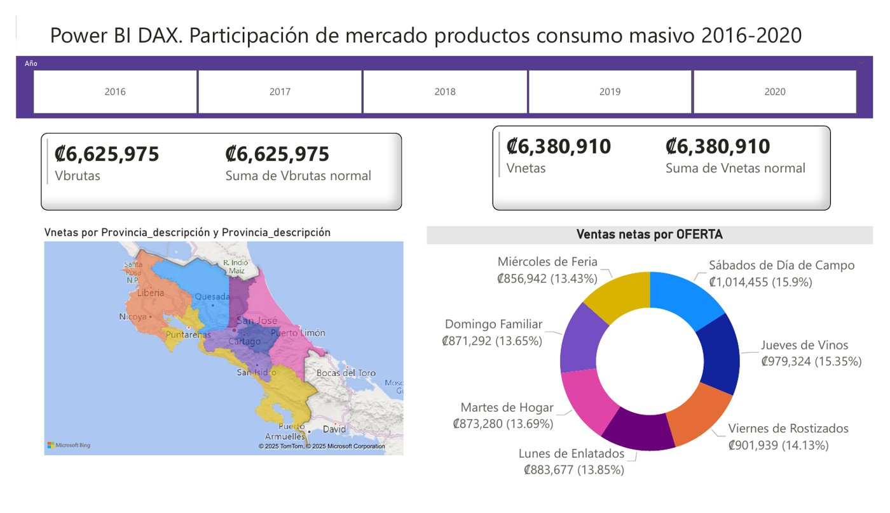
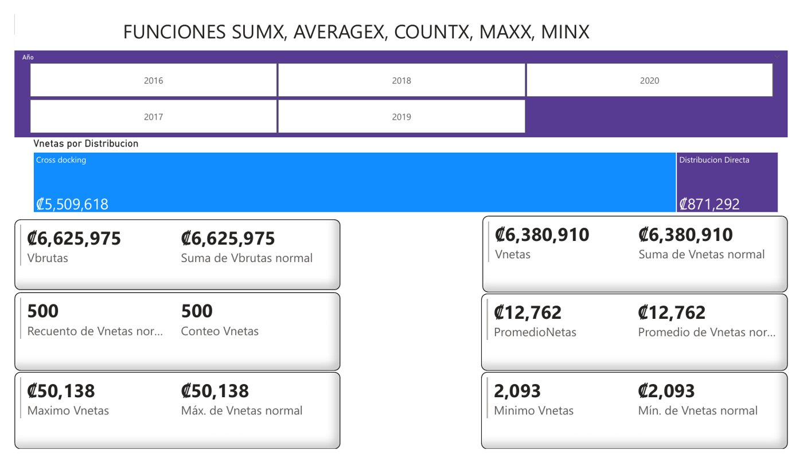
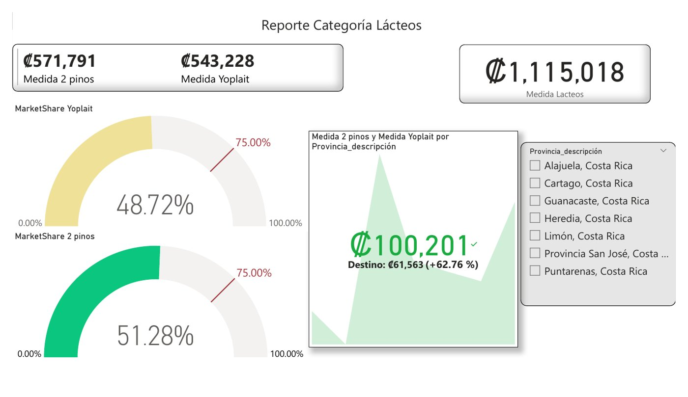
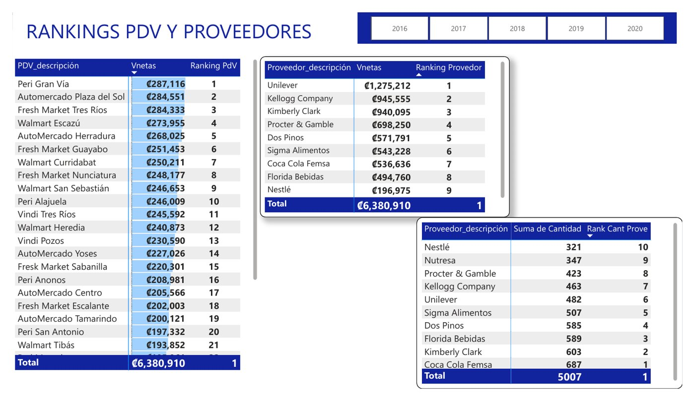
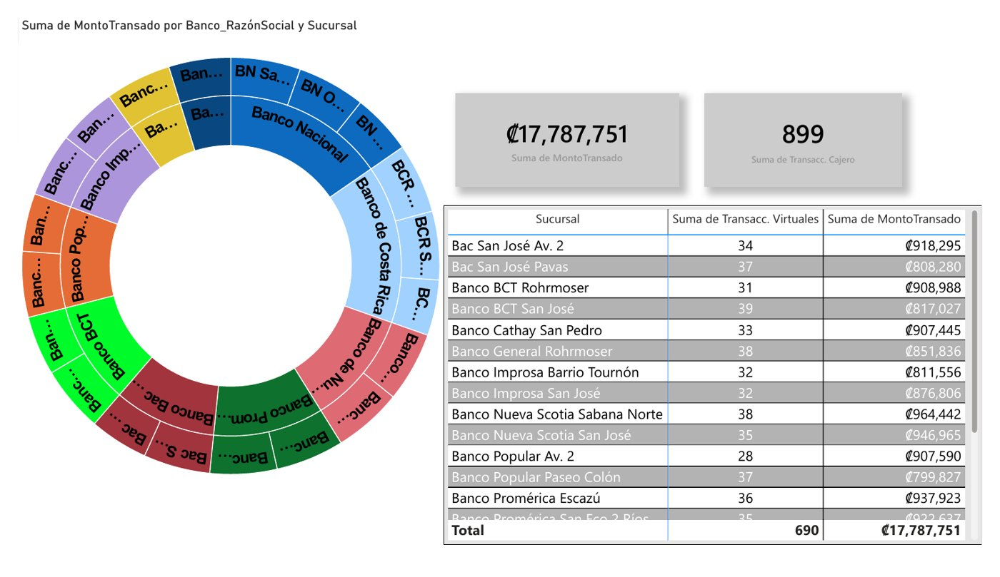
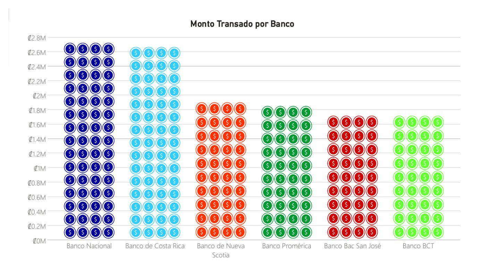
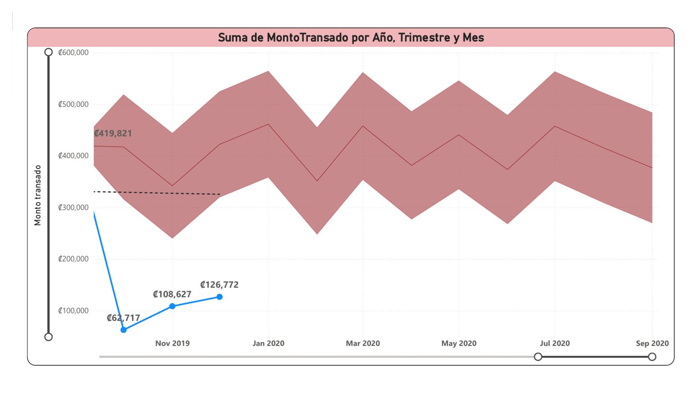
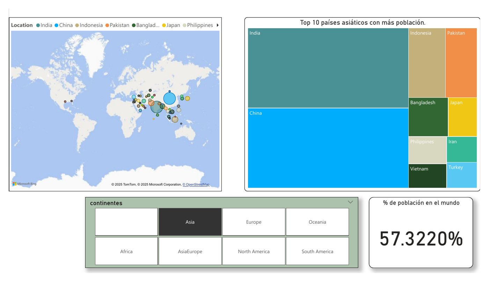
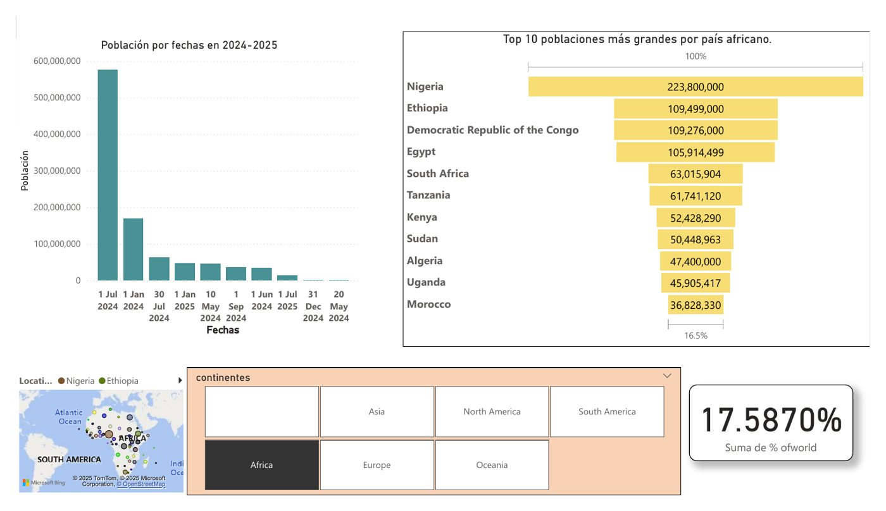

# Power BI Dashboards

Three Power BI reports covering retail market share, banking transactions in Costa Rica and world population. Each folder contains the exported report (PDF) and, where available, the `.pbix` file.

| Report | Highlights | Files |
|---|---|---|
| [Consumer goods market share](#1-consumer-goods-market-share-2016-2020) | DAX measures, iterator functions, KPI targets, rankings | [`.pbix`](consumer-goods-market-share/market-share.pbix) · [PDF](consumer-goods-market-share/market-share.pdf) |
| [Bank transactions in Costa Rica](#2-bank-transactions-in-costa-rica) | Map, sunburst, decomposition by province and product, time trend | [PDF](bank-transactions-costa-rica/bank-transactions.pdf) |
| [World population](#3-world-population) | Continent slicers, maps, share-of-world KPIs | [PDF](world-population/world-population.pdf) |

## 1. Consumer goods market share (2016–2020)

An 11-page report on sales of consumer goods by store chain, point of sale, brand and province, built around DAX measures:

- **Gross vs net sales** and measures that keep the total regardless of slicers, used for share-of-total percentages.
- **Iterator functions** (`SUMX`, `AVERAGEX`, `COUNTX`, `MAXX`, `MINX`) compared side by side with their plain aggregations.
- **Category reports** (dairy, beverages) with market-share gauges against a 75% target and KPI cards against a goal.
- **Rankings** of points of sale and suppliers, and filtered tables per store chain.

More pages

## 2. Bank transactions in Costa Rica

An 8-page report on transaction amounts by bank, branch, province and product:

- Branch map by province with province buttons.
- Sunburst of amount by bank and branch, with branch-level detail table.
- Decomposition of the transacted amount by province and product (credit cards, loans, insurance, accounts).
- Amount by year, quarter and month.

More pages

## 3. World population

A 7-page report with one page per continent: population maps, top-10 countries, and each continent's share of world population driven by a continent slicer.

More pages

## Tools

Power BI Desktop, DAX, Power Query.
